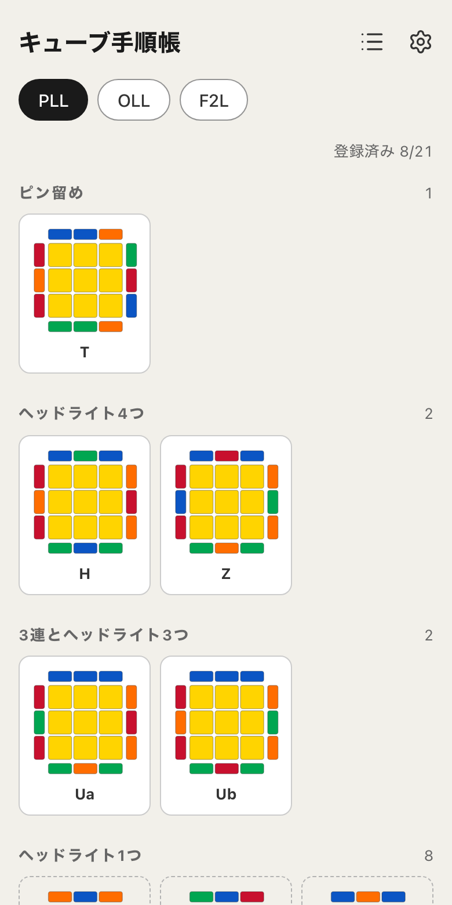
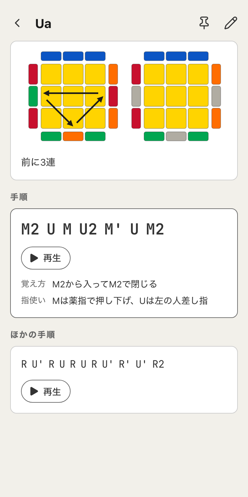

# キューブ手順帳

スピードキューブの手順を、自分の判断と覚え方ごと図で残す手順帳

## どんなアプリか

3x3の練習中に「あれどう回すんだっけ」となったら開く手順帳。
図の隣に、選んだ手順と、どこを見て見分けるかと、自分の覚え方が並ぶ。

書いたものは端末の中だけに残り、どこにも送られない。消える心配があるときはJSONに書き出しておける。
iPhoneのSafariは、しばらく開かないサイトのデータを消すことがある。ホーム画面に追加すると対象から外れる。

| 一覧 | 詳細 |
| --- | --- |
|  |  |

## 主な機能

- PLL 21、OLL 57、F2L 41のプリセットと基本手順。自作のカテゴリとパターンも作れる
- 手順ごとに判断、覚え方、指使い。ほかの手順も並べて置ける
- 上面図と3Dの図。上面の色と前面の色は自分の持ち方に合わせる
- 1手ずつの再生。関係ないパーツを灰色にして、見たい面だけ残す
- 回転記号の一覧
- ピン留め、並び順、リスト表示
- JSONで書き出し・読み込み
- ライトとダーク、テーマ色

## 開発

端末の中だけで動く静的なページ。サーバーもログインも計測もない。
ページ自体はネットワークから読むので、オフラインでは開けない。

- 画面はReact 19 (React Compiler) とTypeScript。組み立てはVite、見た目はTailwind CSS v4とトークン
- 状態はZustandの1ストア。保存はlocalStorageの1文書で、読むときにZodで検証する
- 壊れた文書は捨てずに退避し、1世代前の控えを残す。最初の書き込みで`navigator.storage.persist()`を呼ぶ
- 記号の解析と検証は自前のパーサー。cubing.jsは状態の計算と再生の3Dに使い、図は自前のSVGで描く
- テストはVitestとTesting Library
- CIで型、lint、整形、テスト、ビルドを通す。mainに入るとGitHub Pagesへ配信される

Node.jsとpnpmの版は`.tool-versions`にある。

```sh
pnpm install
pnpm dev          # http://localhost:5173/
pnpm test
pnpm build
```

`pnpm lint`、`pnpm format-check`、`pnpm type-check`はCIと同じ検査を手元で行う。
作業の規則は`CLAUDE.md`と`.claude/skills/`にある。
